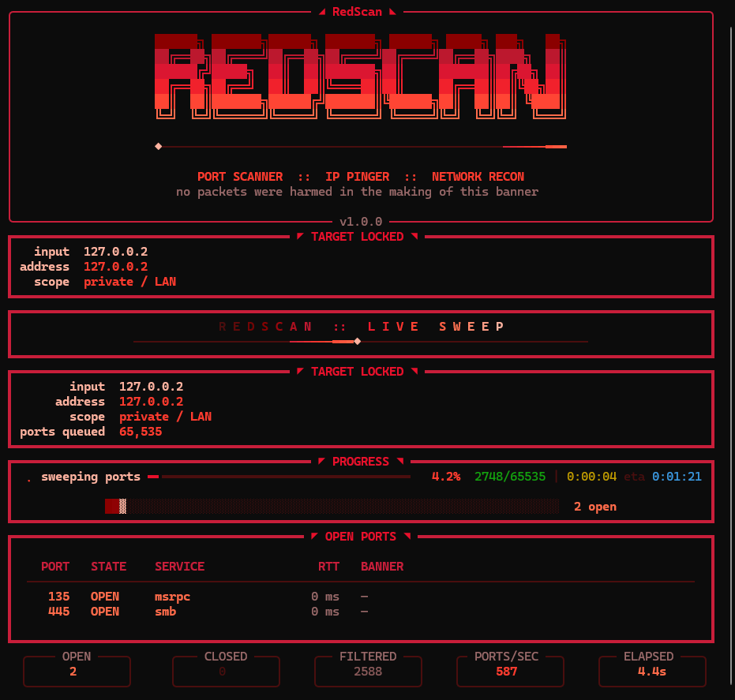
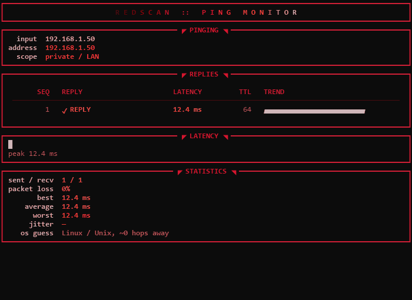

<p align="center">
  
</p>

<h1 align="center">RedScan</h1>

<p align="center">
  <strong>An unreasonably good looking port scanner and IP pinger for the terminal.</strong><br>
  Live radar sweep, plasma-lit banner, banner grabbing, latency sparklines —
  in angry red, or in five palettes that will not sit still.<br>
  And when a host goes offline, a warhead falls out of the sky.
</p>

<p align="center">
  
  
  
  
</p>

<p align="center">
  <a href="https://github.com/gavingimmestad/redscan/releases/latest/download/redscan.exe"><strong>⬇ Download redscan.exe for Windows</strong></a>
  &nbsp;·&nbsp; <a href="https://github.com/gavingimmestad/redscan/releases/latest">all releases</a>
</p>

<p align="center">
  
</p>

<p align="center">
  <br>
  <em>What the ping monitor does when a target stops answering. Every glyph is ASCII.</em>
</p>

```
██████╗ ███████╗██████╗ ███████╗ ██████╗ █████╗ ███╗   ██╗
██╔══██╗██╔════╝██╔══██╗██╔════╝██╔════╝██╔══██╗████╗  ██║
██████╔╝█████╗  ██║  ██║███████╗██║     ███████║██╔██╗ ██║
██╔══██╗██╔══╝  ██║  ██║╚════██║██║     ██╔══██║██║╚██╗██║
██║  ██║███████╗██████╔╝███████║╚██████╗██║  ██║██║ ╚████║
╚═╝  ╚═╝╚══════╝╚═════╝ ╚══════╝ ╚═════╝╚═╝  ╚═╝╚═╝  ╚═══╝
         PORT SCANNER  ::  IP PINGER  ::  RECON
```

---

## Why

Because `nmap` output is grey, and a tool you look at for ten minutes at a time
should be worth looking at. RedScan does the same honest work — TCP connect
scanning, ICMP latency, service fingerprints — behind a dashboard that updates
live in a single shade of angry red. Or, if you would rather it did not, in a
palette whose hues rotate while you watch.

## Features

| | |
|---|---|
| **Live scan dashboard** | Radar sweep header, ember-gradient progress bar, a coverage strip that fills as the port list burns down, and open ports that appear the instant they answer |
| **88 curated ports** | The ports that actually tell you something, named — `ssh`, `smb`, `redis`, `mongodb`, `plex`, `rabbitmq-ui` and friends |
| **Full 65,535 sweep** | 400 concurrent socket workers by default, thousands of ports per second on a LAN |
| **Banner grabbing** | Service fingerprints pulled straight off the socket, with a real `HEAD` request on HTTP-ish ports |
| **Ping monitor** | Live ICMP latency with per-reply heat bars, a history sparkline, loss, jitter and a TTL-based OS guess |
| **TCP ping** | Latency to a single port, for the many networks where ICMP is dropped on the floor |
| **No admin needed** | No raw sockets anywhere — ICMP goes through the system `ping`, everything else is a plain TCP connect |
| **Exports** | `--json` and `--csv` for when the pretty version has to become a ticket |
| **Interactive menu** | Double-click the `.exe` and it asks what you want instead of printing usage and vanishing |
| **Offline alarm** | When a host that was answering stops, a warhead drops out of the clouds: one white-out, a shockwave that flattens the skyline, a mushroom cloud, fallout. Computed fresh in pure ASCII, scaled to your terminal and painted in your palette |
| **Six palettes** | Red by default. `--trip` picks one of five psychedelic ones, where the banner is lit by a moving plasma field, the radar grows three comet heads, borders breathe and every hue rotates in real time |

## Install

### Grab the executable

Download [`redscan.exe`](https://github.com/gavingimmestad/redscan/releases/latest/download/redscan.exe)
from the [latest release](https://github.com/gavingimmestad/redscan/releases/latest)
and run it. It is a single self-contained file: no Python, no dependencies,
nothing to install.

- **Double-click it** for the interactive menu.
- **Or run it from a terminal** in the download folder:
  `.\redscan.exe 192.168.1.1` (every command under [Usage](#usage) works the same way).

The exe is not code-signed, so the first launch may show a Windows SmartScreen
prompt: choose *More info* → *Run anyway*.

### Run from source

```bash
git clone https://github.com/gavingimmestad/redscan.git
cd redscan
pip install -r requirements.txt
python -m redscan
```

## Usage

The examples call it `redscan`; with the downloaded exe that is `.\redscan.exe`,
and from source it is `python -m redscan`.

```bash
redscan                             # interactive menu
redscan 192.168.1.1                 # scan the 88 curated ports
redscan example.com -p 1-1024       # scan a range
redscan 10.0.0.5 -p full            # all 65,535 ports
redscan 8.8.8.8 --ping-only -c 0    # continuous ping monitor, Ctrl+C to stop
redscan router.lan -P -p top        # ping first, then scan
redscan 10.0.0.5 --tcp-ping 443     # latency to one port, no ICMP
redscan scanme.nmap.org --json out.json --csv ports.csv
redscan --net-info                  # this machine's addresses
redscan --trip 192.168.1.1          # same scan, considerably less red
redscan --nuke                      # preview what happens when a target goes offline
redscan --palette vapor             # pick a specific palette
redscan --list-palettes             # see them all first
```

### When a target goes offline

The ping monitor drops a warhead on any target that goes dark, and logs a line
saying when, and another when it comes back. It tries not to cry wolf:

- It takes **three unanswered pings in a row**. One lost packet is weather.
- The target must have **answered at least once**. A host that never replied has
  not gone anywhere; more often than not that is a firewall eating ICMP.
- Each outage gets **one detonation**, and the alarm re-arms when the host returns.

It plays on the alternate screen, so your scrollback is untouched and the dashboard
comes straight back, and the flash fades out once rather than strobing. `--no-anim`
keeps the log lines and skips the show, as does piping the output somewhere. To see
it without taking anything down, run `redscan --nuke`, with `--trip` if you want it
in colours no explosion has ever been.

### Palettes

```
  acid *  ██████████████████████  purple into magenta into molten yellow
kaleido *  ██████████████████████  the full spectrum, spinning hard
    oil *  ██████████████████████  iridescent oil slick on wet asphalt
      red  ██████████████████████  the original: ash, blood, crimson, ember, flare
  ultra *  ██████████████████████  blacklight: UV violet and electric mint
  vapor *  ██████████████████████  vaporwave: indigo, hot pink, pool-water cyan
```

`*` marks the palettes that move. Their hues rotate continuously, so the same
colour asked for a second apart comes back different — which is what drives the
plasma-lit logo, the scrolling gradients, the breathing borders and the
rippling coverage strip. `red` is still the default and still perfectly still.

Press `8` in the interactive menu to repaint mid-session, or answer `random`
there to be surprised. Nothing about the *data* changes with the palette: glyph
heights, counts and progress mean exactly the same thing in every one of them.

### Options

| Flag | Meaning |
|---|---|
| `-p, --ports` | `top`, `full`, `22,80,443`, `1-1024`, or any mix |
| `-P, --ping` | Ping the target before scanning |
| `--ping-only` | Ping and skip the scan |
| `-c, --count` | Ping count, `0` for continuous (default `4`) |
| `-i, --interval` | Seconds between pings (default `1.0`) |
| `--tcp-ping PORT` | Measure latency to a TCP port instead of ICMP |
| `-w, --workers` | Concurrent socket workers (default `400`) |
| `-t, --timeout` | Per-port connect timeout in seconds (default `0.6`) |
| `--timeout-ms` | Ping timeout in milliseconds (default `1200`) |
| `--no-banner` | Skip banner grabbing (faster, quieter) |
| `--no-anim` | Skip the startup and detonation animations |
| `--nuke` | Preview the offline alarm and exit; touches no network |
| `--palette NAME` | `red`, `acid`, `vapor`, `oil`, `ultra` or `kaleido` |
| `--trip` | Pick a random psychedelic palette |
| `--list-palettes` | Show every palette and exit |
| `--json`, `--csv` | Write results to disk |
| `--net-info` | Show local addresses and exit |

### Reading the results

| State | Meaning |
|---|---|
| `OPEN` | The TCP handshake completed |
| `closed` | The host actively refused — something is listening on that address, just not on that port |
| `filtered` | Silence until timeout, which usually means a firewall dropped the packet |

## Build the executable yourself

```powershell
pip install -r requirements-dev.txt
python tools/make_icon.py      # regenerate the radar icon (optional)
./build.ps1
```

The one-file binary lands in `dist/redscan.exe`, with the radar icon and a
Windows version resource read from `redscan/__init__.py`. `build.ps1` runs under
both Windows PowerShell 5.1 and PowerShell 7. On Linux or macOS:

```bash
pip install -r requirements-dev.txt
pyinstaller --onefile --name redscan --console --collect-all rich run_redscan.py
```

### Releases

GitHub Actions builds and smoke-tests the exe on every push. Pushing a version
tag publishes it:

```bash
git tag v1.0.1 && git push origin v1.0.1
```

The workflow builds `redscan.exe` on Windows, runs it against `127.0.0.1`, and
attaches it to a GitHub release for that tag.

## Layout

```
redscan/
├── redscan/
│   ├── theme.py     palettes, hue spin, gradients, plasma, Rich theme
│   ├── banner.py    the oversized logo, the radar sweep, the ripple rule
│   ├── nuke.py      the offline alarm: warhead, shockwave, mushroom cloud
│   ├── net.py       resolution, ICMP/TCP ping, threaded scanning
│   ├── ui.py        every panel, table, sparkline and stat tile
│   └── cli.py       arguments, palette selection, interactive menu, exports
├── tests/           385 tests, including real sockets on loopback
├── tools/
│   ├── make_icon.py renders assets/redscan.ico with no image libraries
│   └── make_demo.py renders the detonation to assets/nuke.gif, no terminal needed
├── run_redscan.py   PyInstaller entry point
├── build.ps1        one-file Windows build
└── .github/workflows/build.yml   CI build, v* tags publish a release
```

## Tests

```bash
pip install -r requirements-dev.txt
python -m pytest
```

Most of the UI suite runs twice, once on a still palette and once on a moving
one, asserting on the information rather than the colours: a tall sparkline bar
has to mean a slow reply no matter what hue it happens to be.

## Scan only what you are allowed to scan

Port scanning hosts you do not own or have written permission to test is, in a
lot of places, illegal, and in most of the rest it is a quick way to get your
address blocked. Point RedScan at your own machines, your own network, or a host
that explicitly invites it such as `scanme.nmap.org`.

## License

MIT — see [LICENSE](LICENSE).
